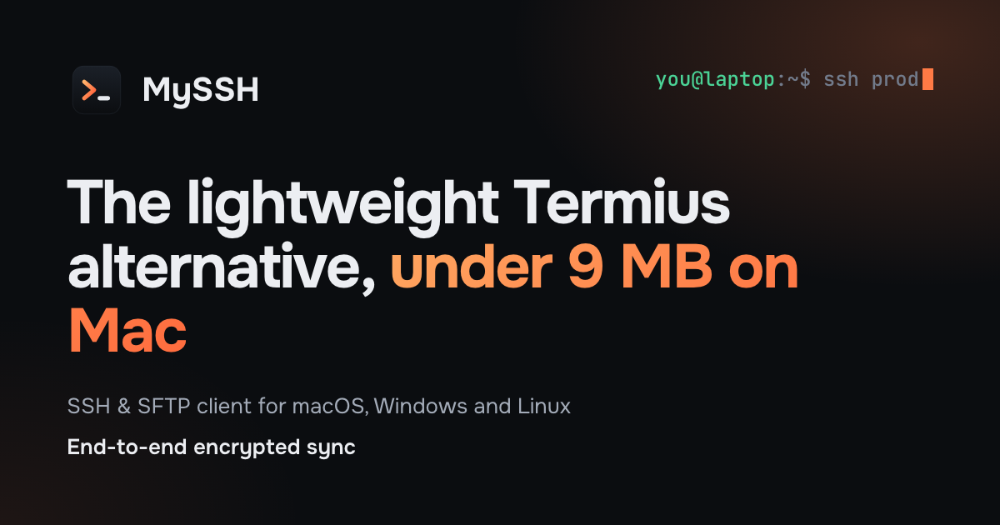
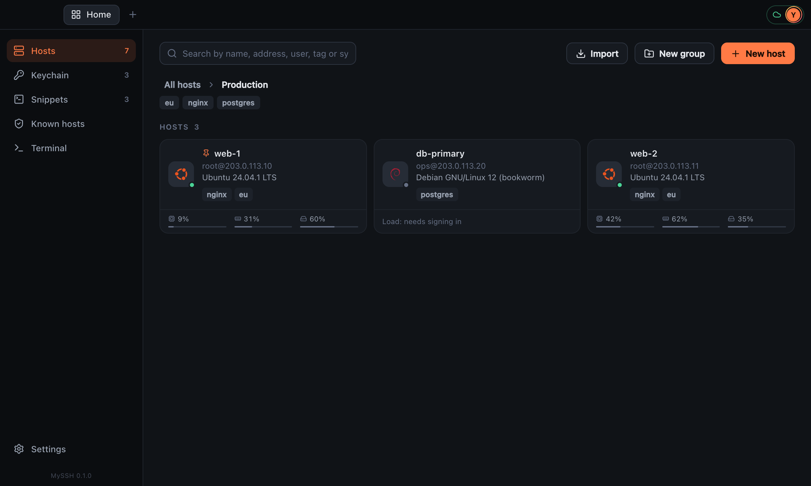
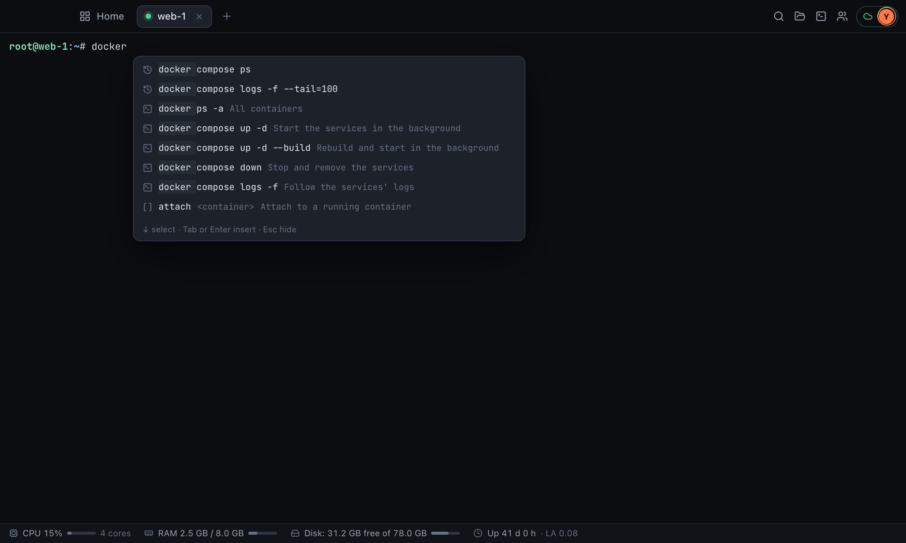
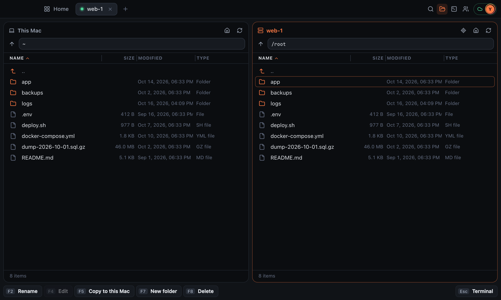

<div align="center">


# MySSH

**A fast, lightweight SSH and SFTP client for macOS, Windows and Linux.**<br>
Hosts, terminal, SFTP, snippets and SSH keys in one small app, with end-to-end encrypted sync between devices.

[](https://github.com/dev-x64/myssh-app/releases/latest)


[**Website**](https://myssh.app) · [**Download**](https://myssh.app/download/) · [**Security**](https://myssh.app/security/) · [**MySSH vs Termius**](https://myssh.app/vs-termius/) · [**Release notes**](https://github.com/dev-x64/myssh-app/releases)

<br>



</div>

<br>

## Download

| Platform | Requirements | Get it |
| --- | --- | --- |
| **macOS** | Any Mac with Apple Silicon (M1 and newer) | [`.dmg`](https://cloud.myssh.app/download?os=mac) |
| **Windows** | Windows 10 or 11, 64-bit | [`setup.exe`](https://cloud.myssh.app/download?os=windows) |
| **Linux** | x86_64 desktop: Ubuntu 22.04+, Debian 12+, Fedora 36+ and other current distributions | [`.AppImage`](https://cloud.myssh.app/download?os=linux) |

Every build is also attached to the [latest release](https://github.com/dev-x64/myssh-app/releases/latest). The app updates itself: updates are signed and checked against a key built into the app before they are installed.

<details>
<summary><b>Install on Linux with one command</b></summary>

<br>

Run as your regular user, without `sudo`:

```sh
curl -q -fsSL https://myssh.app/install.sh | sh
```

The script downloads the latest AppImage to `~/Applications/MySSH.AppImage` and makes it executable. It installs no system packages, touches no SSH keys or settings, and does not launch the app. [Read it](https://myssh.app/install.sh) before running it if you like.

Manual install: download the AppImage, keep it in a permanent folder, run `chmod +x MySSH_*.AppImage` and open it. Some distributions need FUSE 2 installed separately; see the [manual instructions](https://myssh.app/download/#linux-fuse).

</details>

## Why MySSH

- **Small and quick.** The core is written in Rust, with no Electron and no browser bundled inside. The Mac installer is under 9 MB.
- **Free for everything on your computer.** No account needed: hosts, terminal, SFTP, snippets and keys all work locally, and nothing leaves the computer but update checks.
- **Private by design.** Sync is end-to-end encrypted; the server stores only ciphertext. SSH and SFTP go straight from your computer to the server, never through the MySSH cloud.
- **No analytics, no telemetry, no advertising.**

## A look inside

<p align="center">
  
  <br><sub><b>Hosts</b> — groups, tags, search, and each server's load at a glance</sub>
</p>

<p align="center">
  
  <br><sub><b>Terminal</b> — suggestions from history, snippets and the subcommands of docker, git and more</sub>
</p>

<p align="center">
  
  <br><sub><b>SFTP</b> — over the connection already open, in the folder the terminal is in</sub>
</p>

## Features

| | |
| --- | --- |
| 🖥️ **Hosts** | Groups, tags and search by name, address, user, tag or OS. MySSH detects each server's OS, notices hosts that share a login so a password is changed once for all of them, and lets you pin the ones you use most. Advanced mode shows each server's CPU, memory and disk load and whether it is online. |
| ⌨️ **Terminal** | Suggestions while you type: command history, paths on the server, snippets, container names, and the subcommands of `docker`, `git`, `systemctl`, `apt`, `kubectl` and `npm` with the arguments each takes. Errors, warnings, IP addresses and links stand out; a dropped connection reconnects by itself. |
| 🎨 **Colour schemes** | MySSH Dark and Light, Nord, Dracula, Aura, Solarized Dark and Light, Monokai, Night Owl. |
| 📁 **SFTP** | Part of every session: one button opens it over the SSH connection already open, with no second sign-in. Two panes, copy both ways, change permissions, edit files in the built-in editor or any app on your computer. Copies queue up and run three at a time; a folder can go as a single tar stream, much faster for many small files. |
| ✨ **AI suggestions** | Write what you want in plain words, in any language, and get a command. It is only put on the line — nothing runs until you press Enter — and risky commands are marked. Passwords, tokens and keys are removed on the device before sending. Needs an account; can be turned off. |
| 💻 **Local terminal** | Your own shell — zsh or bash on a Mac, PowerShell on Windows, your shell on Linux — in a tab beside your servers. |
| 📋 **Snippets** | Saved commands and scripts, inserted or run in one click on any host. MySSH notices commands you run often and offers to save them. |
| 📥 **Import** | From `~/.ssh/config`, FileZilla, MobaXterm, PuTTY and WinSCP found on the computer, or from an export file. Folders become groups, key files go into the keychain. |
| 🔗 **Tailscale** | Import the machines of your tailnet; their tiles show whether they are online and whether they run Tailscale SSH. |
| 🔑 **SSH keys** | Generate Ed25519, ECDSA or RSA keys or import your own (OpenSSH, PEM, PuTTY). Install a key on many servers at once; MySSH confirms each one by signing in with it. |
| ☁️ **Sync** <sup>Pro</sup> | Hosts, snippets, settings and trusted server keys follow you between Mac, Windows and Linux, encrypted on the device before they are sent. Different changes to the same host on two devices are merged field by field. |
| 👥 **Shared sessions** <sup>Pro</sup> | Invite someone into your terminal with a link; one person types at a time. Off until you turn it on. |

## Security

- **End-to-end encryption.** Records are encrypted on the device with XChaCha20-Poly1305 before they are sent.
- **Master password never leaves the device.** Argon2id derives an encryption key that stays on the device and a sign-in key, of which the server keeps only a hash.
- **The server sees almost nothing.** Not host names or addresses, logins, passwords, SSH keys, snippets or settings — not even the type of a record.
- **SSH keys sync only if you turn it on** for each key; off by default.
- **Server keys are checked.** A server's fingerprint is shown on first contact, and a changed key stops the connection.
- **Local vault** is one file encrypted with XChaCha20-Poly1305 under a random 256-bit key.

The full write-up, including what none of this protects against, is on the [security page](https://myssh.app/security/).

## Free and Pro

**Free** covers everything MySSH does on your own computer, with no account and no time limit.<br>
**Pro** is an optional yearly subscription that adds end-to-end encrypted sync, shared terminal sessions and many more AI suggestions. It pays for the sync servers and funds further development. See [myssh.app](https://myssh.app) for the current price.

## Feedback

Found a bug or have an idea? [Open an issue](https://github.com/dev-x64/myssh-app/issues) or write to [support@myssh.app](mailto:support@myssh.app).

<br>

<div align="center">
<sub>MySSH is made by one solo developer. It is not affiliated with Termius; Termius is a trademark of its owner.</sub>
</div>
